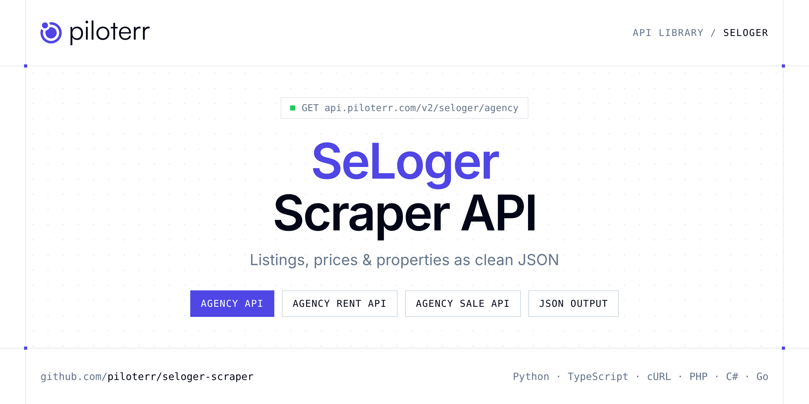

<p align="center">
  <a href="https://www.piloterr.com"></a>
</p>

# SeLoger Scraper API

[](https://discord.gg/CFj3ph8aHU) [](https://app.piloterr.com) [](https://app.piloterr.com/openapi) [](LICENSE)

The **Piloterr SeLoger Scraper API** lets you extract public data from SeLoger as **clean, structured JSON** — no proxies, headless browsers or HTML parsing to maintain. Endpoints available in production:

- **SeLoger Agency API** — Retrieve detailed profile information for a SeLoger real estate agency including contact details, ratings, reviews, and address.
- **SeLoger Agency Rent API** — Retrieve paginated rental property listings published by a specific SeLoger agency using its numeric agency ID.
- **SeLoger Agency Sale API** — Retrieve paginated sale property listings published by a specific SeLoger agency using its numeric agency ID.
- **SeLoger Property API** — Efficiently extract detailed data from a SeLoger real estate listing including agency info, pricing, photos, description, and property criteria.
- **SeLoger Search API** — Efficiently extract real estate listings from SeLoger search pages for market insights, property management, and investment analysis.

Use it for property price monitoring, market analytics, investment sourcing or rental yield models.

| Endpoint | Path | Credits | What you get |
|---|---|---|---|
| [SeLoger Agency API](#seloger-agency-api) | `/v2/seloger/agency` | 2 | Retrieve detailed profile information for a SeLoger real estate agency including contact details, ratings, reviews, and address. |
| [SeLoger Agency Rent API](#seloger-agency-rent-api) | `/v2/seloger/agency/rent` | 2 | Retrieve paginated rental property listings published by a specific SeLoger agency using its numeric agency ID. |
| [SeLoger Agency Sale API](#seloger-agency-sale-api) | `/v2/seloger/agency/sale` | 2 | Retrieve paginated sale property listings published by a specific SeLoger agency using its numeric agency ID. |
| [SeLoger Property API](#seloger-property-api) | `/v2/seloger/property` | 2 | Efficiently extract detailed data from a SeLoger real estate listing including agency info, pricing, photos, description, and property criteria. |
| [SeLoger Search API](#seloger-search-api) | `/v2/seloger/search` | 2 | Efficiently extract real estate listings from SeLoger search pages for market insights, property management, and investment analysis. |

## Table of contents

- [How it works](#how-it-works)
- [SeLoger Agency API](#seloger-agency-api)
- [SeLoger Agency Rent API](#seloger-agency-rent-api)
- [SeLoger Agency Sale API](#seloger-agency-sale-api)
- [SeLoger Property API](#seloger-property-api)
- [SeLoger Search API](#seloger-search-api)
- [Code examples in other languages](#code-examples-in-other-languages)
- [Practical use cases](#practical-use-cases)
- [Why Piloterr?](#why-piloterr)
- [FAQ](#faq)
- [Related scrapers](#related-scrapers)
- [Support](#support)

## How it works

1. **Create a free Piloterr account** and copy your API key from the [dashboard](https://app.piloterr.com).
2. **Send a `GET` (or `POST`) request** to `https://api.piloterr.com/v2/...` with the header `x-api-key: YOUR_API_KEY`.
3. **Receive structured JSON** — Piloterr handles rendering, proxies, retries and parsing.

```bash
export PILOTERR_API_KEY="your-api-key"
pip install requests        # Python
# TypeScript: Node.js 18+ (native fetch), run with `npx tsx file.ts`
```

> Every endpoint accepts both `GET` (query string) and `POST` (JSON body with the same fields).

## SeLoger Agency API

Retrieve detailed profile information for a SeLoger real estate agency including contact details, ratings, reviews, and address.

`GET | POST https://api.piloterr.com/v2/seloger/agency` · **2 credits per request** · [Full reference](https://app.piloterr.com/openapi)

### Request parameters

| Parameter | Type | Required | Description |
|---|---|---|---|
| `query` | string | ✅ | A valid SeLoger agency profile URL. |

### Python example

```python
import json
import os
import requests

response = requests.get(
    "https://api.piloterr.com/v2/seloger/agency",
    headers={"x-api-key": os.environ["PILOTERR_API_KEY"]},
    params={
        "query": "https://www.seloger.com/professionnels/agences-immobilieres/castanet-tolosan-31320/agence-21719",
    },
    timeout=60,
)
response.raise_for_status()
data = response.json()

print(json.dumps(data, indent=2, ensure_ascii=False)[:2000])
```

### TypeScript example

```typescript
type SelogerAgency = {
  id?: string;
  logo?: {
    alt?: string;
    src?: string;
  };
  name?: string;
  email?: string;
  siret?: string;
  banner?: {
    alt?: string;
    src?: unknown;
  };
  id_rcu?: string;
  rating?: {
    value?: number;
    reviews_count?: number;
  };
  address?: {
    city?: string;
    street?: string;
    zip_code?: string;
  };
  fee_url?: string;
  reviews?: {
    count?: number;
    result?: unknown[];
  };
  website?: string;
  id_tiers?: string;
  is_seller?: unknown;
  languages?: string;
  legal_form?: unknown;
  sold_count?: unknown;
  agency_type?: number;
  description?: unknown;
  phone_number?: string;
  intermediary_id?: number;
  social_networks?: unknown[];
  sold_properties?: unknown;
  intermediary_type?: number;
  environment_source?: string;
  [key: string]: unknown;
};

const params = new URLSearchParams({
  "query": "https://www.seloger.com/professionnels/agences-immobilieres/castanet-tolosan-31320/agence-21719",
});

const response = await fetch(`https://api.piloterr.com/v2/seloger/agency?${params}`, {
  headers: { "x-api-key": process.env.PILOTERR_API_KEY! },
});
if (!response.ok) throw new Error(`Piloterr error ${response.status}: ${await response.text()}`);

const data = (await response.json()) as SelogerAgency;

console.log(JSON.stringify(data, null, 2).slice(0, 2000));
```

<details>
<summary><b>POST variant</b></summary>

```http
POST https://api.piloterr.com/v2/seloger/agency
x-api-key: YOUR_API_KEY
Content-Type: application/json

{"query": "https://www.seloger.com/professionnels/agences-immobilieres/castanet-tolosan-31320/agence-21719"}
```
</details>

### Output example

Example response from the API reference, abridged — real values depend on the page you scrape.

```json
{
  "id": "73866",
  "logo": {
    "alt": "Logo du pro L'ADRESSE CASTANET TOLOSAN",
    "src": "04yui7bokni23pkvnpeje9fsrpfqf364vk6xbc1qo"
  },
  "name": "L'ADRESSE CASTANET TOLOSAN",
  "email": "example",
  "siret": "51965411500020",
  "banner": {
    "alt": "Banniere du pro L'ADRESSE CASTANET TOLOSAN",
    "src": null
  },
  "id_rcu": "RC-079919",
  "rating": {
    "value": 4.8,
    "reviews_count": 129
  },
  "address": {
    "city": "Castanet Tolosan",
    "street": "43 avenue de Toulouse ",
    "zip_code": "31320"
  },
  "fee_url": "https://media.immo-facile.com/segments/immo/catalog/images/manufacturers_bareme/72614.pdf",
  "reviews": {
    "count": 129,
    "result": []
  },
  "website": "http://www.ladresse-castanet.com",
  "id_tiers": "102577",
  "is_seller": null,
  "languages": "en,es,fr",
  "legal_form": null,
  "sold_count": null,
  "agency_type": 0,
  "description": null,
  "phone_number": "example",
  "intermediary_id": 21719,
  "social_networks": [],
  "sold_properties": null,
  "intermediary_type": 1,
  "environment_source": "SELOGER"
}
```

### Response fields

| Field | Type | Description |
|---|---|---|
| `id` | string |  |
| `logo` | object |  |
| `logo.alt` | string |  |
| `logo.src` | string |  |
| `name` | string |  |
| `email` | string |  |
| `siret` | string |  |
| `banner` | object |  |
| `banner.alt` | string |  |
| `banner.src` | object |  |
| `id_rcu` | string |  |
| `rating` | object |  |
| `rating.value` | number |  |
| `rating.reviews_count` | integer |  |
| `address` | object |  |
| `address.city` | string |  |
| `address.street` | string |  |
| `address.zip_code` | string |  |
| `fee_url` | string |  |
| `reviews` | object |  |
| `reviews.count` | integer |  |
| `reviews.result` | any[] |  |
| `website` | string |  |
| `id_tiers` | string |  |
| `is_seller` | object |  |

## SeLoger Agency Rent API

Retrieve paginated rental property listings published by a specific SeLoger agency using its numeric agency ID.

`GET | POST https://api.piloterr.com/v2/seloger/agency/rent` · **2 credits per request** · [Full reference](https://app.piloterr.com/openapi)

### Request parameters

| Parameter | Type | Required | Description |
|---|---|---|---|
| `query` | string | ✅ | A valid SeLoger agency ID. |
| `page` | number | — | Page number for paginating through the agency's rental listings. |

### Python example

```python
import json
import os
import requests

response = requests.get(
    "https://api.piloterr.com/v2/seloger/agency/rent",
    headers={"x-api-key": os.environ["PILOTERR_API_KEY"]},
    params={
        "query": "18317",
    },
    timeout=60,
)
response.raise_for_status()
data = response.json()

print(json.dumps(data, indent=2, ensure_ascii=False)[:2000])
```

### TypeScript example

```typescript
type SelogerAgencyRent = {
  count?: number;
  result?: {
    id?: string;
    url?: string;
    type?: number;
    image?: {
      alt?: unknown;
      src?: string;
    };
    price?: number;
    surface?: number;
    rooms_count?: number;
    bedrooms_count?: number;
    locality_label?: string;
  }[];
};

const params = new URLSearchParams({
  "query": "18317",
});

const response = await fetch(`https://api.piloterr.com/v2/seloger/agency/rent?${params}`, {
  headers: { "x-api-key": process.env.PILOTERR_API_KEY! },
});
if (!response.ok) throw new Error(`Piloterr error ${response.status}: ${await response.text()}`);

const data = (await response.json()) as SelogerAgencyRent;

console.log(JSON.stringify(data, null, 2).slice(0, 2000));
```

<details>
<summary><b>POST variant</b></summary>

```http
POST https://api.piloterr.com/v2/seloger/agency/rent
x-api-key: YOUR_API_KEY
Content-Type: application/json

{"query": "18317"}
```
</details>

### Output example

Example response from the API reference, abridged — real values depend on the page you scrape.

```json
{
  "count": 1,
  "result": [
    {
      "id": "263165015",
      "url": "https://www.seloger-bureaux-commerces.com/annonces/location/local-commercial/paris-11eme/263165015",
      "type": 7,
      "image": {
        "alt": null,
        "src": "https://v.seloger.com/s/width/400/visuels/0/2/c/y/02cyrydlv40zdojea0frfgvs3g39ali32o6m6jc45.jpg"
      },
      "price": 908,
      "surface": 66,
      "rooms_count": 0,
      "bedrooms_count": 0,
      "locality_label": "Paris 11ème"
    }
  ]
}
```

### Response fields

| Field | Type | Description |
|---|---|---|
| `count` | integer |  |
| `result[]` | object[] |  |
| `result[].id` | string |  |
| `result[].url` | string |  |
| `result[].type` | integer |  |
| `result[].image` | object |  |
| `result[].price` | integer |  |
| `result[].surface` | integer |  |
| `result[].rooms_count` | integer |  |
| `result[].bedrooms_count` | integer |  |
| `result[].locality_label` | string |  |

## SeLoger Agency Sale API

Retrieve paginated sale property listings published by a specific SeLoger agency using its numeric agency ID.

`GET | POST https://api.piloterr.com/v2/seloger/agency/sale` · **2 credits per request** · [Full reference](https://app.piloterr.com/openapi)

### Request parameters

| Parameter | Type | Required | Description |
|---|---|---|---|
| `query` | string | ✅ | A valid SeLoger agency ID. |
| `page` | number | — | Page number for paginating through the agency's sale listings. |

### Python example

```python
import json
import os
import requests

response = requests.get(
    "https://api.piloterr.com/v2/seloger/agency/sale",
    headers={"x-api-key": os.environ["PILOTERR_API_KEY"]},
    params={
        "query": "18317",
    },
    timeout=60,
)
response.raise_for_status()
data = response.json()

print(json.dumps(data, indent=2, ensure_ascii=False)[:2000])
```

### TypeScript example

```typescript
type SelogerAgencySale = {
  count?: number;
  result?: {
    id?: string;
    url?: string;
    type?: number;
    image?: {
      alt?: unknown;
      src?: string;
    };
    price?: number;
    surface?: number;
    rooms_count?: number;
    bedrooms_count?: number;
    locality_label?: string;
  }[];
};

const params = new URLSearchParams({
  "query": "18317",
});

const response = await fetch(`https://api.piloterr.com/v2/seloger/agency/sale?${params}`, {
  headers: { "x-api-key": process.env.PILOTERR_API_KEY! },
});
if (!response.ok) throw new Error(`Piloterr error ${response.status}: ${await response.text()}`);

const data = (await response.json()) as SelogerAgencySale;

console.log(JSON.stringify(data, null, 2).slice(0, 2000));
```

<details>
<summary><b>POST variant</b></summary>

```http
POST https://api.piloterr.com/v2/seloger/agency/sale
x-api-key: YOUR_API_KEY
Content-Type: application/json

{"query": "18317"}
```
</details>

### Output example

Example response from the API reference, abridged — real values depend on the page you scrape.

```json
{
  "count": 21,
  "result": [
    {
      "id": "251442903",
      "url": "https://www.seloger.com/annonces/achat/appartement/boulogne-billancourt-92/silly-gallieni/251442903.htm",
      "type": 1,
      "image": {
        "alt": null,
        "src": "https://v.seloger.com/s/width/800/visuels/1/4/o/b/14obdze5vc9jkjkg5xhz1m2yr4z6oofk2ls1vb2ga.jpg"
      },
      "price": 449000,
      "surface": 60,
      "rooms_count": 3,
      "bedrooms_count": 2,
      "locality_label": "Boulogne-Billancourt"
    },
    {
      "id": "262053933",
      "url": "https://www.seloger.com/annonces/achat/appartement/paris-13eme-75/olympiades-choisy/262053933.htm",
      "type": 1,
      "image": {
        "alt": null,
        "src": "https://v.seloger.com/s/width/800/visuels/0/f/m/a/0fma04f1ouosugxx7d77pguuyz4ohv5euyxhalgdm.jpg"
      },
      "price": 483000,
      "surface": 94,
      "rooms_count": 5,
      "bedrooms_count": 3,
      "locality_label": "Paris 13ème"
    }
  ]
}
```

### Response fields

| Field | Type | Description |
|---|---|---|
| `count` | integer |  |
| `result[]` | object[] |  |
| `result[].id` | string |  |
| `result[].url` | string |  |
| `result[].type` | integer |  |
| `result[].image` | object |  |
| `result[].price` | integer |  |
| `result[].surface` | integer |  |
| `result[].rooms_count` | integer |  |
| `result[].bedrooms_count` | integer |  |
| `result[].locality_label` | string |  |

## SeLoger Property API

Efficiently extract detailed data from a SeLoger real estate listing including agency info, pricing, photos, description, and property criteria.

`GET | POST https://api.piloterr.com/v2/seloger/property` · **2 credits per request** · [Full reference](https://app.piloterr.com/openapi)

### Request parameters

| Parameter | Type | Required | Description |
|---|---|---|---|
| `query` | string | ✅ | A valid SeLoger property listing URL. |
| `return_page_source` | boolean | — | Whether to return the raw HTML source of the property page instead of parsed JSON data. |

### Python example

```python
import json
import os
import requests

response = requests.get(
    "https://api.piloterr.com/v2/seloger/property",
    headers={"x-api-key": os.environ["PILOTERR_API_KEY"]},
    params={
        "query": "https://www.seloger.com/annonces/achat/appartement/bordeaux-33/capucins-saint-michel-nansouty-saint-genes/234462129.htm",
    },
    timeout=60,
)
response.raise_for_status()
data = response.json()

print(json.dumps(data, indent=2, ensure_ascii=False)[:2000])
```

### TypeScript example

```typescript
type SelogerProperty = {
  agency?: {
    id?: number;
    logo?: string;
    name?: string;
    id_rcu?: string;
    rating?: {
      rating?: number;
      review_url?: string;
      review_count?: number;
    };
    address?: string;
    tier_id?: number;
    fees_url?: string;
    description?: unknown;
    website_url?: string;
    legal_notice?: {
      rcs_siren?: string;
      legal_form?: unknown;
      is_individual?: boolean;
      share_capital?: number;
      social_reason?: string;
      headquarter_address?: string;
      financial_guarantee_fund?: string;
      professional_card_number?: unknown;
      financial_guarantee_amount?: number;
      professional_card_prefecture?: unknown;
    };
    phone_number?: string;
    contact_hidden?: boolean;
    profession_type?: string;
    profil_page_url?: string;
    organisation_logo?: unknown;
  };
  seeker?: unknown;
  contact?: {
    book_a_visit?: {
      slots?: unknown;
      enabled?: boolean;
      event_type?: unknown;
      required_form?: boolean;
      plato_agency_id?: unknown;
      allowed_contracts?: unknown;
      unpaid_rent_garanty?: boolean;
      unpaid_rent_garanty_rate?: number;
    };
  };
  listing?: {
    url?: {
      value?: string;
      nature?: number;
      business_unit_type?: string;
    };
    early_access?: unknown;
    listing_detail?: {
      id?: number;
      media?: Record<string, unknown>;
    };
  };
};

const params = new URLSearchParams({
  "query": "https://www.seloger.com/annonces/achat/appartement/bordeaux-33/capucins-saint-michel-nansouty-saint-genes/234462129.htm",
});

const response = await fetch(`https://api.piloterr.com/v2/seloger/property?${params}`, {
  headers: { "x-api-key": process.env.PILOTERR_API_KEY! },
});
if (!response.ok) throw new Error(`Piloterr error ${response.status}: ${await response.text()}`);

const data = (await response.json()) as SelogerProperty;

console.log(JSON.stringify(data, null, 2).slice(0, 2000));
```

<details>
<summary><b>POST variant</b></summary>

```http
POST https://api.piloterr.com/v2/seloger/property
x-api-key: YOUR_API_KEY
Content-Type: application/json

{"query": "https://www.seloger.com/annonces/achat/appartement/bordeaux-33/capucins-saint-michel-nansouty-saint-genes/234462129.htm"}
```
</details>

### Output example

Example response from the API reference, abridged — real values depend on the page you scrape.

```json
{
  "agency": {
    "id": 336312,
    "logo": "https://v.seloger.com/s/width/150/logos/0/h/0/l/0h0leun3rcbdmdyf0pb8fdq1wkqufnq0wjzms4qw6.jpg",
    "name": "Efficity   Gael Brossaud",
    "id_rcu": "RC-267721",
    "rating": {
      "rating": 4.9,
      "review_url": "/professionnels/agents-commerciaux/paris-13eme-arrondissement-75013/agence-18317/#?avisImmo=true",
      "review_count": 139
    },
    "address": "",
    "tier_id": 399543,
    "fees_url": "http://diszln7ft1ccx.cloudfront.net/pdf/BAREME_NATIONAL.pdf",
    "description": null,
    "website_url": "https://www.efficity.com/gbrossaud",
    "legal_notice": {
      "rcs_siren": "813142676",
      "legal_form": null,
      "is_individual": false,
      "share_capital": 116847,
      "social_reason": "SAS",
      "headquarter_address": "48 avenue de Villiers 75017 Paris",
      "financial_guarantee_fund": "GALIAN Assurances",
      "professional_card_number": null,
      "financial_guarantee_amount": 500000,
      "professional_card_prefecture": null
    },
    "phone_number": "example",
    "contact_hidden": false,
    "profession_type": "Agents commerciaux",
    "profil_page_url": "/professionnels/agents-commerciaux/paris-13eme-arrondissement-75013/agence-18317/",
    "organisation_logo": null
  },
  "seeker": null,
  "contact": {
    "book_a_visit": {
      "slots": null,
      "enabled": false,
      "event_type": null,
      "required_form": false,
      "plato_agency_id": null,
      "allowed_contracts": null,
      "unpaid_rent_garanty": false,
      "unpaid_rent_garanty_rate": 0
    }
  },
  "listing": {
    "url": {
      "value": "https://www.seloger.com/annonces/achat/appartement/bordeaux-33/capucins-saint-michel-nansouty-saint-genes/234462129.htm",
      "nature": 1,
      "business_unit_type": "SL"
    },
    "early_access": null,
    "listing_detail": {
      "id": 234462129,
      "media": {
        "photos": [
          {}
        ]
      }
    }
  }
}
```

### Response fields

| Field | Type | Description |
|---|---|---|
| `agency` | object |  |
| `agency.id` | integer |  |
| `agency.logo` | string |  |
| `agency.name` | string |  |
| `agency.id_rcu` | string |  |
| `agency.rating` | object |  |
| `agency.address` | string |  |
| `agency.tier_id` | integer |  |
| `agency.fees_url` | string |  |
| `agency.description` | object |  |
| `agency.website_url` | string |  |
| `agency.legal_notice` | object |  |
| `agency.phone_number` | string |  |
| `agency.contact_hidden` | boolean |  |
| `agency.profession_type` | string |  |
| `agency.profil_page_url` | string |  |
| `agency.organisation_logo` | object |  |
| `seeker` | object |  |
| `contact` | object |  |
| `contact.book_a_visit` | object |  |
| `listing` | object |  |
| `listing.url` | object |  |
| `listing.early_access` | object |  |
| `listing.listing_detail` | object |  |

## SeLoger Search API

Efficiently extract real estate listings from SeLoger search pages for market insights, property management, and investment analysis.

`GET | POST https://api.piloterr.com/v2/seloger/search` · **2 credits per request** · [Full reference](https://app.piloterr.com/openapi)

### Request parameters

| Parameter | Type | Required | Description |
|---|---|---|---|
| `query` | string | ✅ | A valid SeLoger search results URL. Any SeLoger search page URL with filters is supported: location, property type, price range, surface, and number of rooms can all be embedded in the URL. |
| `return_page_source` | boolean | — | Whether to return the raw HTML source of the search results page instead of parsed JSON data. |

### Python example

```python
import json
import os
import requests

response = requests.get(
    "https://api.piloterr.com/v2/seloger/search",
    headers={"x-api-key": os.environ["PILOTERR_API_KEY"]},
    params={
        "query": "https://www.seloger.com/annonces/achat/appartement/bordeaux-33/",
    },
    timeout=60,
)
response.raise_for_status()
data = response.json()

print(json.dumps(data, indent=2, ensure_ascii=False)[:2000])
```

### TypeScript example

```typescript
type SelogerSearch = {
  id?: number;
  epc?: unknown;
  tags?: string[];
  rooms?: number;
  title?: string;
  is_new?: boolean;
  nature?: number;
  photos?: string[];
  contact?: {
    email?: string;
    id_rcu?: string;
    img_url?: string;
    agency_id?: number;
    agency_link?: unknown;
    agency_page?: unknown;
    contact_name?: string;
    phone_number?: string;
    is_private_seller?: boolean;
  };
  pricing?: {
    price?: string;
    lifetime?: boolean;
    raw_price?: string;
    price_note?: unknown;
    monthly_price?: number;
    square_meter_price?: string;
  };
  surface?: number;
  position?: number;
  zip_code?: string;
  card_type?: string;
  transport?: unknown;
  city_label?: string;
  desk_count?: number;
  photos_qty?: number;
  description?: string;
  estate_type?: string;
  video_u_r_l?: unknown;
  early_access?: unknown;
  is_exclusive?: boolean;
  bedroom_count?: number;
  business_unit?: number;
  [key: string]: unknown;
}[];

const params = new URLSearchParams({
  "query": "https://www.seloger.com/annonces/achat/appartement/bordeaux-33/",
});

const response = await fetch(`https://api.piloterr.com/v2/seloger/search?${params}`, {
  headers: { "x-api-key": process.env.PILOTERR_API_KEY! },
});
if (!response.ok) throw new Error(`Piloterr error ${response.status}: ${await response.text()}`);

const data = (await response.json()) as SelogerSearch;

console.log(JSON.stringify(data, null, 2).slice(0, 2000));
```

<details>
<summary><b>POST variant</b></summary>

```http
POST https://api.piloterr.com/v2/seloger/search
x-api-key: YOUR_API_KEY
Content-Type: application/json

{"query": "https://www.seloger.com/annonces/achat/appartement/bordeaux-33/"}
```
</details>

### Output example

Example response from the API reference, abridged — real values depend on the page you scrape.

```json
[
  {
    "id": 227349507,
    "epc": null,
    "tags": [
      "4 pièces",
      "3 chambres"
    ],
    "rooms": 4,
    "title": "Appartement neuf",
    "is_new": false,
    "nature": 2,
    "photos": [
      "/0/k/z/2/0kz2n5mhqtt4d922z0yk7ey61booyo9gqe5ikflog.jpg",
      "/1/f/4/v/1f4v1cu618rao9z3jydwi7re88naslrnrie78v3i8.jpg"
    ],
    "contact": {
      "email": "example",
      "id_rcu": "RC-082608",
      "img_url": "https://v.seloger.com/s/width/150/logos/0/x/q/v/0xqv4maey1fc6dtb7les934ocr8k2ue8850ffaueo.jpg",
      "agency_id": 76929,
      "agency_link": null,
      "agency_page": null,
      "contact_name": "example",
      "phone_number": "example",
      "is_private_seller": false
    },
    "pricing": {
      "price": "716 000 €",
      "lifetime": false,
      "raw_price": "716000",
      "price_note": null,
      "monthly_price": 3596,
      "square_meter_price": "7 282 €"
    },
    "surface": 98.32,
    "position": 0,
    "zip_code": "33200",
    "card_type": "classified",
    "transport": null,
    "city_label": "Bordeaux",
    "desk_count": 0,
    "photos_qty": 6,
    "description": "",
    "estate_type": "Appartement neuf",
    "video_u_r_l": null,
    "early_access": null,
    "is_exclusive": false,
    "bedroom_count": 3,
    "business_unit": 2
  },
  {
    "id": 232159607,
    "epc": "C",
    "tags": [
      "3 pièces",
      "2 chambres"
    ],
    "rooms": 3,
    "title": "Appartement",
    "is_new": false,
    "nature": 1,
    "photos": [
      "/0/3/f/l/03flt9ozsl0o40fysnzj5d8m9lko4ozrtprgxgyw0.jpg",
      "/0/0/3/q/003qpl4f372irog1qjnwkibqaix3ul4s4uoll7j4w.jpg"
    ],
    "contact": {
      "email": "example",
      "id_rcu": "RC-035271",
      "img_url": "https://v.seloger.com/s/width/150/logos/1/i/8/7/1i870528o8j063099u4r7sk9gqvgr35b1ur2ejaez.jpg",
      "agency_id": 3088,
      "agency_link": null,
      "agency_page": "/professionnels/agences-immobilieres/bordeaux-33000/agence-48208/",
      "contact_name": "example",
      "phone_number": "example",
      "is_private_seller": false
    },
    "pricing": {
      "price": "472 000 €",
      "lifetime": false,
      "raw_price": "472000",
      "price_note": null,
      "monthly_price": 2525,
      "square_meter_price": "6 743 €"
    },
    "surface": 70,
    "position": 1,
    "zip_code": "33000",
    "card_type": "classified",
    "transport": null,
    "city_label": "Bordeaux",
    "desk_count": 0,
    "photos_qty": 7,
    "description": "Appartement à vendre - BORDEAUX - QUAIS DES CHARTRONS...",
    "estate_type": "Appartement",
    "video_u_r_l": null,
    "early_access": null,
    "is_exclusive": false,
    "bedroom_count": 2,
    "business_unit": 1
  }
]
```

### Response fields

| Field | Type | Description |
|---|---|---|

## Code examples in other languages

Ready-to-run examples live in the [`examples/`](examples) folder. Each one reads your key from the `PILOTERR_API_KEY` environment variable.

| Language | Agency | Agency Rent | Agency Sale | Property | Search |
|---|---|---|---|---|---|
| cURL (Bash) | [`agency`](examples/curl/agency.sh) | [`agency-rent`](examples/curl/agency_rent.sh) | [`agency-sale`](examples/curl/agency_sale.sh) | [`property`](examples/curl/property.sh) | [`search`](examples/curl/search.sh) |
| PHP | [`agency`](examples/php/agency.php) | [`agency-rent`](examples/php/agency_rent.php) | [`agency-sale`](examples/php/agency_sale.php) | [`property`](examples/php/property.php) | [`search`](examples/php/search.php) |
| C# | [`agency`](examples/csharp/Agency.cs) | [`agency-rent`](examples/csharp/AgencyRent.cs) | [`agency-sale`](examples/csharp/AgencySale.cs) | [`property`](examples/csharp/Property.cs) | [`search`](examples/csharp/Search.cs) |
| Go | [`agency`](examples/go/agency.go) | [`agency-rent`](examples/go/agency_rent.go) | [`agency-sale`](examples/go/agency_sale.go) | [`property`](examples/go/property.go) | [`search`](examples/go/search.go) |
| Java | [`agency`](examples/java/AgencyExample.java) | [`agency-rent`](examples/java/AgencyRentExample.java) | [`agency-sale`](examples/java/AgencySaleExample.java) | [`property`](examples/java/PropertyExample.java) | [`search`](examples/java/SearchExample.java) |
| Ruby | [`agency`](examples/ruby/agency.rb) | [`agency-rent`](examples/ruby/agency_rent.rb) | [`agency-sale`](examples/ruby/agency_sale.rb) | [`property`](examples/ruby/property.rb) | [`search`](examples/ruby/search.rb) |
| Node.js | [`agency`](examples/nodejs/agency.mjs) | [`agency-rent`](examples/nodejs/agency_rent.mjs) | [`agency-sale`](examples/nodejs/agency_sale.mjs) | [`property`](examples/nodejs/property.mjs) | [`search`](examples/nodejs/search.mjs) |

## Practical use cases

- **Price monitoring** — Track asking prices and price drops per area.
- **Market analytics** — Measure inventory, days on market and price per m² / sqft.
- **Investment sourcing** — Detect undervalued properties as soon as they are listed.
- **Rental yield models** — Combine sale and rent listings to estimate yields.
- **Proptech products** — Power portals, valuation tools and alerts with structured listings.

## Why Piloterr?

- **No infrastructure** — no proxies, headless browsers or CAPTCHA solving to run yourself.
- **Structured JSON** — stable, documented fields instead of brittle HTML selectors.
- **Pay per request** — transparent credit cost per endpoint, failed requests are retried for you.
- **One API key, hundreds of sources** — SeLoger plus many other e-commerce, search and company data endpoints in the [Piloterr library](https://www.piloterr.com/library).
- **Any language** — plain HTTPS + JSON, with examples for Python, TypeScript, cURL, PHP, C#, Go, Java, Ruby and Node.js.

## FAQ

### Is it legal to scrape SeLoger?

Collecting publicly available data is generally allowed in many jurisdictions, but rules depend on your country, the data you collect and how you use it. Avoid personal data unless you have a lawful basis, respect the website's terms where they apply, and get legal advice for your specific use case. This is not legal advice.

### Do I need proxies or a headless browser?

No. Piloterr handles rendering, proxy rotation and retries on its side. You only send an HTTPS request with your `x-api-key` header and receive JSON.

### How much does a request cost?

Credits per call: `/v2/seloger/agency` **2**, `/v2/seloger/agency/rent` **2**, `/v2/seloger/agency/sale` **2**, `/v2/seloger/property` **2**, `/v2/seloger/search` **2**. See the [Piloterr website](https://www.piloterr.com) for plans.

### What data does the SeLoger API return?

Each endpoint returns structured JSON: **SeLoger Agency** — `id`, `logo`, `logo.alt`, `logo.src`, `name`, `email`; **SeLoger Agency Rent** — `count`, `result[]`, `result[].id`, `result[].url`, `result[].type`, `result[].image`; **SeLoger Agency Sale** — `count`, `result[]`, `result[].id`, `result[].url`, `result[].type`, `result[].image`; **SeLoger Property** — `agency`, `agency.id`, `agency.logo`, `agency.name`, `agency.id_rcu`, `agency.rating`.

### How do I paginate SeLoger results?

Use the `page` parameter and keep requesting while the response indicates more results.

### Can I get the raw HTML instead of JSON?

Yes. Set `return_page_source=true` and the response becomes `{"result": "..."}` with the page source.

### Which languages are supported?

Any language that can make an HTTP request. This README shows Python and TypeScript; the [`examples/`](examples) folder contains cURL, PHP, C#, Go, Java, Ruby and Node.js.

## Related scrapers

- [Apartments Scraper API](https://github.com/piloterr/apartments-scraper)
- [Argenprop Scraper API](https://github.com/piloterr/argenprop-scraper)
- [Centris Scraper API](https://github.com/piloterr/centris-scraper)
- [Fotocasa Scraper API](https://github.com/piloterr/fotocasa-scraper)
- [Funda Scraper API](https://github.com/piloterr/funda-scraper)
- [Homestra Scraper API](https://github.com/piloterr/homestra-scraper)
- [All Piloterr scrapers on GitHub](https://github.com/piloterr)

## Support

- 💬 Join the [Piloterr Discord](https://discord.gg/CFj3ph8aHU) to ask questions and share what you build.
- 📚 Browse the [API reference (OpenAPI)](https://app.piloterr.com/openapi) and the [Piloterr library](https://www.piloterr.com/library).
- 🔑 [Get your API key](https://app.piloterr.com).

---

<p align="center">
  <a href="https://www.piloterr.com">
    <picture>
      <source media="(prefers-color-scheme: dark)" srcset="images/logo-dark.svg">
      
    </picture>
  </a>
  <br>
  <sub>Built by <a href="https://www.piloterr.com">Piloterr</a> — web scraping APIs for e-commerce, search, real estate and more, one API key.</sub>
</p>

<sub>SeLoger is a trademark of its respective owner. This repository is not affiliated with or endorsed by SeLoger. Examples are released under the MIT license.</sub>
